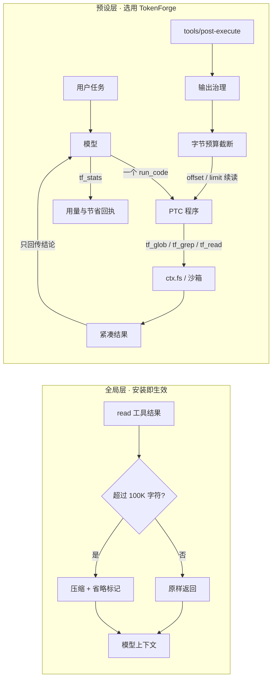

[Uploading README.md…]()
# dsh-tokenforge · 词元锻造
[WIP] TokenForge - 一个极其暴力的无状态上下文截断器 (不支持回捞)。

> ⚠️ 警告：本插件为极客工具，仅针对超长日志/上下文有奇效。日常对话无感。请勿用于核心代码重构（可能因截断导致幻觉）。
> ⚠️ 已知限制：由于宿主底层隔离机制，当前版本不支持自动回捞截断的内容。tf_result 工具当前不可用。请仅在读取巨型日志并接受首尾截断（或前 2000 行）的情况下使用。

## 适用与不适用

| 场景 | 建议 |
|---|---|
| `*.log`、报错堆栈、巨型 JSON/JSONL | ✅ 推荐 |
| 核心业务代码的重构、逐行语义分析 | ❌ 不推荐；请提高阈值或关闭 |
| 日常闲聊、写小函数 | 不需要 |

面向 **DeepSeek Harness**（`dsh >= 0.2.0`、`node >= 20.11.0`）的 token 效率插件。安装后立即获得一个**全局读守卫**：任何超过 100K 字符的 `read` 结果，在进入模型上下文前被压成“头 + 尾 + 省略标记”；再选用可选的 `tokenforge` 预设，获得 PTC 批量工具与完整的输出治理。

`DSH >= 0.2.0` · `Node >= 20.11.0` · `v1.0.1` · `MIT`

## 两层机制

| 层 | 是否默认 | 作用 |
|---|---|---|
| **全局读守卫**（`tokenforge-read-guard`） | **安装即生效** | 拦截宿主 `read` 工具的结果，超过阈值时压缩；不改变磁盘读取、不改变沙箱、不改权限。 |
| **TokenForge 预设**（`tokenforge`） | 可选 | PTC 批量编排、`tf_read`/`tf_grep`/`tf_glob`/`tf_stats`、按 `offset`/`limit` 的物理分页、shell 与 web 输出治理。 |

两层互不依赖：不选预设也能享受读守卫；选了预设则获得完整的省流工具面。预设内原生 `read` 被关闭，因此不会和全局守卫重复处理。

## 它解决什么

- **几百 MB 日志**：`read` 结果先压到 12K 字符以内，模型看到头尾、行号与省略标记，不会因为上下文截断而“断片”。
- **大文件**：预设下只读需要的行区间，不把整文件灌进上下文。
- **多模块审计**：一个 `run_code` 程序里并行发起几十次读取/搜索，中间结果留在程序内，只回传结论。
- **可核对**：`tf_stats` 给出本会话的工具调用、分页读取量与可归因节省量。

## 架构



| 路径 | 职责 |
|---|---|
| `read-guard.js` | 全局读守卫入口；挂 `tools/post-execute`，整体 fail-open |
| `lib/read-guard.js` | 阈值、头尾裁剪、输入上限与静默降级 |
| `tools.js` | 预设入口，只做装配：配置 → runtime → 提示词 → 治理 → 注册工具 |
| `tools/tf-*.js` | 每个工具一个模块，导出 `schema` 与 `createHandler(runtime)` |
| `tools/index.js` | 工具注册表：校验、组装 `ToolDefinition`、注册 |
| `lib/config.js` | 预设配置默认值与边界 |
| `lib/runtime.js` | 会话级状态（统计）与 `cwd`/`sessionId` 绑定 |
| `lib/governor.js` | 预设内 shell/web 输出治理 |
| `lib/policy.js` | 系统提示词策略（纯数据） |
| `lib/compact.js` | 压缩、行号、ANSI、token 估算（纯函数） |
| `lib/fs-walk.js` | `ctx.fs` 遍历、glob、敏感路径、UTF-16 还原 |
| `lib/stats.js` | 会话计数器 |
| `platform/index.js` | 平台白名单与 shell 选择 |

设计约束：

- **全局默认 + 预设可选**：读守卫随安装生效；完整工具面仍由用户显式选择预设。
- **fail-open**：守卫内部任何异常都返回宿主原始结果；只有宿主 `read` 自身的错误会向上传播，不会被伪装成成功。
- **PTC**：预设内模型只直接调用 `run_code`；文件操作在程序内批量执行，中间结果不进入模型上下文。
- **文件边界**：所有文件操作走 `ctx.fs`；`tf_read` 成功后发出 `fs/observed`，官方 `edit`/`write` 仍可用。
- **schema / handler 分离**：工具对模型暴露什么（schema）与怎么执行（handler）各占一个导出，新增工具不改入口。
- **平台隔离**：只支持 `win32` / `darwin` / `linux`；未知平台不猜 shell，但纯 JS 的文本治理照常工作。
- **零系统副作用**：运行时不调用 `child_process`、不直接 import `fs`、不做 `chmod`/`chown`/`icacls`/`Set-Acl`。
- **编码**：优先通过 `ctx.fs.readBytes` 读取原始字节，按 BOM / UTF-8 / UTF-16 / GBK 顺序嗅探；低置信度直接报 `Unsupported Encoding`，绝不返回乱码。
- **安全边界**：预设内 `tf_read`/`tf_grep` 默认跳过 `.ssh`、`.aws`、`.gnupg`、`.kube`、`.docker` 与 `.env*`、私钥、`.npmrc`、`secrets.json` 等；**全局读守卫不做路径判定**，敏感路径的最终放行仍由宿主沙箱决定。
- **无状态分页**：`tf_read` 不维护跨调用的结果缓存，每次只按 `offset`/`limit` 返回磁盘上的物理行区间；截断提示直接写在返回文本里，进程重启后行为不变。

## 安装

```powershell
dsh plugin --profile <profile> add <产品目录>\tokenforge
```

或先打包再安装：

```powershell
cd <产品目录>\tokenforge
npm pack
dsh plugin --profile <profile> add .\dsh-tokenforge-1.0.1.tgz
```

安装或更新后：

1. **全局读守卫立即生效**，不需要新建会话或选择预设。
2. 需要完整 `tf_*` 工具时，新建会话并选择 **TokenForge** 预设；现有会话保持原预设。

> 从 `1.0.0` 起包名为 `dsh-tokenforge`，`cordis.patch.yml` 中的插件名同步为 `dsh-tokenforge/tools` 与 `dsh-tokenforge/read-guard`。旧版 `@local/tokenforge` 的安装不会被覆盖，需要先卸载。

## 工具

| 工具 | 参数 | 返回 |
|---|---|---|
| `tf_read` | `requests: [{ path, offset?, limit? }]`（1–8 个） | 带行号的文件片段；超出预算时在物理行边界截断，用 `offset` 续读。 |
| `tf_grep` | `pattern, path?, include?, mode?: summary\|count\|content, maxFiles?, maxMatches?, caseSensitive?` | 文件/命中计数或命中行。 |
| `tf_glob` | `pattern: string\|string[], path?, maxResults?, details?` | 相对路径列表，支持 `**`、`*`、`?`、`{a,b}`。 |
| `tf_stats` | 无 | 会话 token 估算、工具调用、可归因节省、分页读取量。 |

## 物理分页读取（offset / limit）

`tf_read` 是纯读取器：每次调用只取文件里一段**物理行区间**，返回带行号前缀的文本。没有隐藏的结果缓存，也没有“先存后取”的二次读取。

- `offset` 从 1 开始；`limit` 不超过 `readMaxLines`（默认 2000）。
- 单文件渲染超过 `readMaxCharsPerFile`（默认 32768）、或单次总量超过 `readMaxCharsTotal`（默认 49152）时，在**行边界**截断。
- 截断处直接写明剩余量，例如 `[... 583 more lines truncated; narrow the range ...]`，下一步该用哪个 `offset` 一目了然。
- 续读只需 `offset = 上一段末行号 + 1`；多个区间可在同一次调用的 `requests` 数组里并行发起。

因为不依赖缓存，分页是**确定性**的：同样的 `offset`/`limit` 在任何进程、任何会话都返回同一段文本。被截掉的部分永远可以直接从磁盘续读，而不是从某个可能已被淘汰的缓存里捞。

```
tf_read({ requests: [
  { path: 'app.log', offset: 1,    limit: 2000 },   // 1-2000
  { path: 'app.log', offset: 2001, limit: 2000 },   // 2001-2657，末段自动收窄
  { path: 'app.log', offset: 2658, limit: 2000 },   // 越界：空区间，不报错
] })
```

## 配置

### 全局读守卫

在 `cordis.patch.yml` 的 `tokenforge-read-guard` 行：

| 键 | 默认 | 说明 |
|---|---:|---|
| `enabled` | true | 关闭后守卫完全不注册。 |
| `thresholdChars` | 102400 | 超过 100K 字符才压缩；小文件原样通过。 |
| `headLines` / `tailLines` | 120 / 40 | 压缩时保留的头尾行数；预算不足时自动收缩，但保留省略标记。 |
| `maxOutputChars` | 12000 | 压缩结果字符上限。 |
| `maxInputChars` | 33554432 | 病态输入上限，超出取头尾各一半。 |
| `tools` | `[read]` | 参与拦截的工具名；默认只处理 `read`。 |

关闭全局守卫：

```yaml
- id: tokenforge-read-guard
  name: 'dsh-tokenforge/read-guard'
  config:
    enabled: false
```

### TokenForge 预设

挂到 `tokenforge-tools` 行：

| 键 | 默认 | 说明 |
|---|---:|---|
| `readMaxLines` | 2000 | 单文件单次最大行数。 |
| `readMaxCharsPerFile` | 32768 | 单文件渲染字符上限。 |
| `readMaxCharsTotal` | 49152 | 单次 `tf_read` 总字符上限。 |
| `readMaxFileBytes` | 8388608 | 超过即熔断，不读入内存。 |
| `grepMaxMatches` | 100 | 单次命中上限。 |
| `grepMaxChars` | 12288 | grep 结果字符上限。 |
| `globMaxResults` | 200 | 单次路径上限。 |
| `allowSensitivePaths` | false | 显式允许读取敏感路径；默认关闭。 |
| `governor.thresholdChars` | 8000 | 超过后触发预设内输出治理。 |
| `governor.maxInputChars` | 33554432 | 治理输入硬上限，超出取头尾。 |
| `governor.headLines` / `tailLines` | 120 / 40 | 压缩保留行数。 |
| `governor.tools` | 平台 shell + `web_fetch` + `web_search` | 预设内参与治理的工具白名单。 |

```yaml
- id: tokenforge-tools
  name: 'dsh-tokenforge/tools'
  config:
    allowSensitivePaths: false
    governor:
      thresholdChars: 8000
      maxInputChars: 33554432
      headLines: 120
      tailLines: 40
```

## 平台与安全边界

| 平台 | 支持 | 默认 shell 治理 |
|---|---|---|
| Windows | ✅ | `pwsh` |
| macOS | ✅ | `bash` |
| Linux | ✅ | `bash` |
| 其他（FreeBSD 等） | 文本治理可用，不猜 shell | 无 shell 条目 |

- 平台判断只使用白名单 `win32` / `darwin` / `linux`；未知平台返回 `null`，不猜测 `pwsh` 或 `bash`。
- **没有 ACL 修复逻辑**。TokenForge 不改文件权限、所有者、ACL，也不启动子进程；发布包中不存在 `child_process`、直接 `fs`、`icacls`、`Set-Acl`、`chmod`、`chown` 调用。
- 全局读守卫是纯内存文本变换；它不能阻止宿主读取文件，也不替代沙箱。真正的路径授权始终在 `ctx.fs`。

## FAQ

### 装了之后没反应？

按顺序排查：

1. **阈值**：全局守卫只处理 `read` 结果中超过 `102400` 字符的内容；小文件本来就不会被改动。把 `thresholdChars` 临时调到 `100` 可以验证链路。
2. **预设**：`tf_read`/`tf_grep`/`tf_glob`/`tf_stats` 只存在于 TokenForge 预设里。没选预设时看不到它们是正常的。
3. **安装位置**：确认当前 profile 的 `cordis.patch.yml` 里存在 `tokenforge-read-guard` 行；改的是别的 profile 就不会生效。
4. **仍然无输出**：贴 `tf_stats`（预设下）和宿主日志开 issue，不要只写“没反应”。

### AI 读了文件还是答错了？

压缩是**有损**的。头尾 + 省略标记足够定位问题，但不足以做逐行语义分析。复杂代码分析请任选其一：

- 把 `tokenforge-read-guard.thresholdChars` 调高（例如 `1048576`），或直接 `enabled: false`；
- 使用 TokenForge 预设的 `tf_read` 精确读取区间，而不是让模型读整文件；
- 对需要完整上下文的文件，先 `tf_grep` 定位，再分段读。

### 能不能支持某某大模型？

不能。TokenForge 只适配 DeepSeek Harness 的 `ToolDefinition` / PTC / `tools/post-execute` 契约。其他模型或框架请 fork 后自行修改 prompt 与工具适配层；本项目不接受“支持某模型”的通用改造 PR。

### 会不会改我的权限或 ACL？

不会。运行时没有权限、ACL、进程相关代码。

## 扩展

### 新增一个工具

1. 新建 `tools/tf-<name>.js`，导出 `schema` 与 `createHandler(runtime)`：

```js
import { stringParam, textOutput } from '../lib/tool-kit.js'

export const schema = {
  name: 'tf_count',
  description: 'Count occurrences of a literal in one file.',
  parameters: {
    type: 'object',
    properties: {
      path: stringParam('Workspace-relative path.'),
      needle: stringParam('Literal to count.'),
    },
    required: ['path', 'needle'],
    additionalProperties: false,
  },
  output: textOutput(),
}

export function createHandler(runtime) {
  const { ctx, settings } = runtime
  return async function execute(args, exec) {
    // 走 ctx.fs，不要直接 import node:fs
    return 'count=0'
  }
}
```

2. 在 `tools/index.js` 中 import 并加入 `TOOL_MODULES`（顺序即模型看到的顺序）。
3. 本地验证通过后再合并。

注册表会在加载时校验 `schema` 四个必填项、`createHandler` 是否存在、工具名是否重复；缺项直接抛错，不会带病进入运行时。

### 新增一个平台

- 平台差异集中在 `platform/index.js`：`isSupportedPlatform()`、`shellTool()`、`defaultGovernedTools()`。
- 补丁里用同一条规则只启用一个 shell 行：

```yaml
- id: tool-pwsh
  name: '@deepseek-ai/dsh-tool-pwsh'
  disabled: !!js process.platform !== 'win32'

- id: tool-bash
  name: '@deepseek-ai/dsh-tool-bash'
  disabled: !!js process.platform === 'win32'
```

若新平台的 shell 工具名不同，只需扩展白名单与 `shellTool()`，工具 handler 与治理逻辑不动。

## 基准

两个 A/B 基准都使用**同一 fixture、同一 headless DSH AgentLoop、同一脚本化 mock 模型**，只切换 Native 与 TokenForge/PTC 工具面；token 为 4 字符/token 估算，不是账单记录。

### 输出治理压测

20MB 单行文本压到 11,991 字符，压缩率 **99.94%**，耗时 66 ms，未触发 OOM：

| 场景 | 原始字符数 | 压缩后字符数 | 压缩率 | 耗时 (ms) | 内存峰值 (MiB) |
|---|---:|---:|---:|---:|---:|
| 20 MB 单行 | 20,971,520 | 11,991 | **99.94%** | 65.99 | 53.31 |
| 10 万行 ANSI 日志 | 11,059,413 | 11,991 | 99.89% | 174.72 | 185.43 |
| 巨型重复 JSON | 8,600,389 | 11,638 | 99.86% | 90.85 | 78.96 |
| 全特殊符号 | 408,000 | 69 | 99.98% | 12.56 | 42.41 |
| 空输入 | 0 | 0 | 0.00% | 0.27 | 33.66 |
| 非法 UTF-8 截断 | 19 | 19 | 0.00% | 0.44 | 33.74 |

### 真实 50 文件开源项目

测试集：`dshmarket` 已安装源码的 50 个 `.ts/.tsx` 文件（MIT，Copyright (c) 2026 fkysly and dsh-market contributors），共 25,943 行 / 1,216,394 字符。

| 指标 | Native baseline | TokenForge | 对比 |
|---|---:|---:|---:|
| Token 消耗 | 1,263,467 | 17,825 | **70.88×** |
| 请求轮数 | 11 | 2 | 减少 9 轮 |
| 墙钟耗时 | 5,415 ms | 4,444 ms | 约快 18% |
| 正确性 | `REAL_OK files=50 lines=25943` | 同左 | PASS |

### 六任务保守套件

| 任务 | Native | TokenForge | 倍率 |
|---|---:|---:|---:|
| module-audit（40 模块依赖审计） | 1,507,587 | 20,586 | 73.2× |
| big-file-extract（4,200 行） | 101,109 | 16,986 | 5.9× |
| csv-sum（8,000 行） | 129,696 | 17,085 | 7.6× |
| test-triage（2,400 行日志） | 52,664 | 16,953 | 3.1× |
| config-hunt（3 层 + 12 诱饵） | 39,154 | 17,241 | 2.3× |
| symbol-audit（跨模块符号） | 525,629 | 18,095 | 29.1× |
| **合计** | **2,355,839** | **106,946** | **22.03×** |

真实项目的 70.88× 高于保守套件的 22.03×；两者都只代表机制基准，不代表所有任务或真实模型。

## 兼容性与限制

- 需要 DSH `>= 0.2.0`（见 `package.json` 的 `engines.dsh`）；实测环境为 DSH 1.0.0 / Node 24.21.0。
- 全局读守卫依赖 `tools/post-execute`，只能压缩“结果进入上下文前”的内容，**不能阻止宿主读盘**；真正的文件访问控制属于 `ctx.fs` 与沙箱。
- PTC 依赖模型能写 TypeScript 程序；不支持 PTC 时 preset 不应启用。
- 22.03× / 70.88× / 99.94% 是固定基准的机制结果，不是普遍保证；压缩有损，复杂分析请提高阈值或关闭。
- 分页只由 `offset`/`limit` 决定，不依赖任何进程内缓存；同一次读取在进程重启后仍可复现。
- 符号链接别名到敏感文件的最终放行仍由 `ctx.fs` 沙箱决定；目录遍历会跳过符号链接。
- 当前实现只在单 Host 进程内使用；未来 Worker/多线程需额外同步。
- 包仍为 `private: true`，作为本地插件分发；如需发布到 npm，先移除该字段并补 `publishConfig`。

## License

MIT。方法参考了 dsh-ops 的“紧凑工具 + PTC + 渐进披露”思路，但实现为原创代码，未复制其源码或资源。
